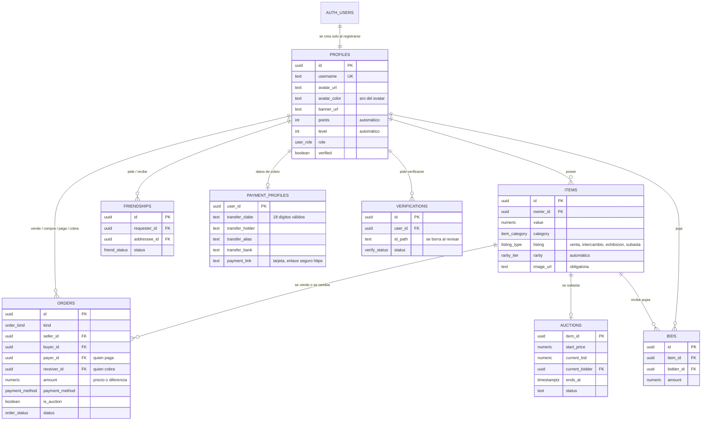

# Diagrama ERD

Imagen lista para el reporte: `erd.png` (o `erd.svg`, que se abre en el navegador).

Versión en texto (Mermaid). GitHub y VS Code con la extensión de Mermaid la dibujan:

## Reglas automáticas (las hace la base de datos, no el navegador)

| Dato | Quién lo calcula | Regla |
|---|---|---|
| `items.rarity` y `items.points` | trigger `trg_items_set_rarity` | según `value`: 500 / 2,500 / 10,000 / 50,000, y 10 / 25 / 60 / 150 / 400 puntos |
| `search_text` | triggers | texto sin acentos, comas ni puntos para el buscador |
| `profiles.points` y `profiles.level` | trigger `trg_items_after_change` | suma de puntos de sus artículos; `1 + floor(raíz(puntos / 25))` |
| Perfil | trigger `on_auth_user_created` | se crea al registrarse |
| Correos | trigger `trg_check_email_domain` | formato válido, sin temporales y sin correos inventados |
| Diferencia en un intercambio | función `create_order` | si valen distinto, quien da la pieza de menor valor paga la diferencia |
| Dueño de los artículos | `complete_order` | cambia al completar una venta o intercambio |
| Subastas | `place_bid`, `finalize_expired_auctions` | puja mínima +5%, alarga 2 min si puja de último momento, el ganador recibe una operación para pagar |
| `profiles.verified` | `review_verification` | solo un admin |
